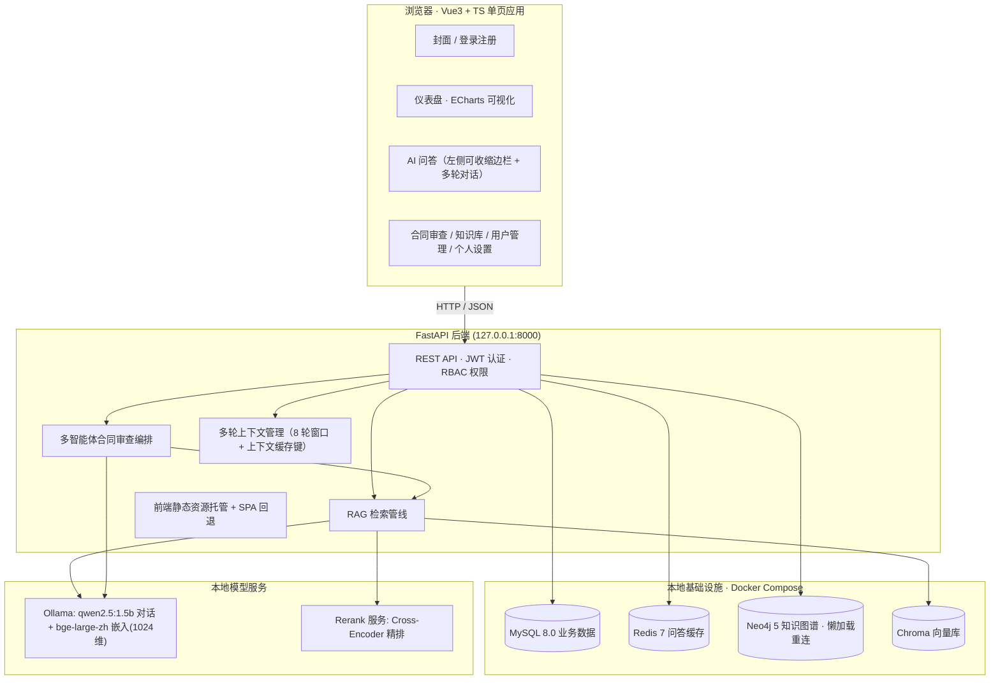

# alawyer 智能法律顾问平台 · 项目需求书

| 项目 | 内容 |
| --- | --- |
| 文档版本 | V1.1 |
| 编制日期 | 2026-09-03 |
| 文档状态 | 与已交付系统同步 |
| 密级 | 内部 |

> alawyer 智能法律顾问平台：基于本地化大语言模型与检索增强生成（RAG）技术的全栈智能法律服务平台，覆盖智能问答、合同审查、知识沉淀三大核心场景，面向普通用户、执业律师与平台管理员三类角色提供差异化服务。

---

## 一、需求背景

### 1.1 业务触发背景

alawyer 平台于 2026 年 8 月发起建设，起因是一组长期存在的矛盾：一方面，中小微企业与个人用户在劳动用工、婚姻家事、合同交易、公司治理、知识产权等高频场景中存在大量法律咨询与文书审查需求；另一方面，专业法律服务的获取门槛高——单次律师咨询通常按小时计费，合同审查按份收费且周期以天计，大量需求因此被搁置或由当事人凭经验自行处理，埋下纠纷隐患。`[PM 判断]`

与此同时，开源大语言模型与检索增强生成技术在 2025—2026 年间趋于成熟：1.5B 参数量级的开源模型已可在消费级硬件上流畅运行，中文专业嵌入模型（bge-large-zh-v1.5，1024 维）与 Cross-Encoder 精排方案让"本地知识库问答"的准确率达到了可用水平。这为构建一套**全本地部署、零外部 API 依赖、数据不出内网**的智能法律服务平台提供了技术窗口。

### 1.2 目标用户痛点

- **咨询贵且慢**：中小企业没有专职法务，遇到"试用期最长能约多久""股东能不能查公司账簿"这类问题时，得不到即时、有依据的解答，只能搜索网络碎片信息，来源不可靠。
- **咨询缺乏连续性**：法律问题往往需要多轮追问才能问清楚，传统问答工具每次提问互相割裂，用户无法基于上一次咨询继续深入。
- **合同审查依赖单点判断**：合同风险的识别高度依赖审查人个人经验，缺乏结构化的多视角校验机制；一份合同"到底改哪里、为什么改"往往说不清楚。
- **法律知识资产无法沉淀**：企业积累的法规解读、案例摘要、合同范本散落在个人电脑中，无法被检索、被复用、被订正，人员变动即知识流失。
- **通用 AI 不可信**：直接使用公有云大模型存在两方面问题——法律答案缺乏出处、无法核验；合同等敏感文本上传至第三方服务存在数据泄露风险。

### 1.3 建设定位与免责边界

本项目的定位是**面向法律场景的本地化智能服务平台**，而非替代律师的自动化系统。平台坚持三条边界：AI 回答必须标注知识库出处，供用户核验；合同审查给出评分与优化建议，最终结论由律师角色复核把关；所有模型推理、向量检索、数据存储均在本机或本地容器内完成。

> **免责边界**：平台所有 AI 产出均附带"仅供参考，具体请咨询执业律师"提示。平台不构成律师—委托人关系，不出具法律意见书，涉及诉讼与重大交易的事项仍需线下法律服务承接。

---

## 二、需求目标

### 2.1 总目标

为三类角色提供一套数据本地化、答案可溯源、审查多视角、权限可管控的智能法律服务平台，把"高频、标准化的法律信息获取"从人工咨询迁移到平台自助完成，把律师角色的精力留给高价值复核工作。

### 2.2 分项目标

| 目标维度 | 目标描述 | 衡量口径 |
| --- | --- | --- |
| 咨询即时化 | 用户法律咨询由 AI 顾问即时响应；命中 Redis 缓存的问题秒级返回，未命中缓存的问题由本地大模型在可等待时间内生成回答，且回答附带知识库出处 | 缓存命中响应 < 1s；模型生成响应 ≤ 3 分钟（qwen2.5:1.5b 本地推理） |
| 咨询连续化 | 支持基于历史咨询的**多轮追问**：用户点击任一历史记录即可恢复该次对话上下文继续提问，AI 回答与前文语义连贯 | 历史恢复 1 次点击完成；追问请求携带最近 8 轮上下文 |
| 审查结构化 | 每份合同经三视角智能体两轮辩论与仲裁官裁决，输出一致性评分（0–100）、五维雷达评分、裁决结论与分点优化方案，替代"单人通读"式审查；律师可对任意用户合同出具复核意见 | 每份合同稳定输出 1 个综合评分、≥3 条智能体意见、≥1 份优化方案 |
| 知识可沉淀 | 支持 txt / md / pdf / docx / xlsx / csv 六类文档导入，自动分块、向量化、抽取关键词并构建知识图谱，形成可检索、可阅读、可订正的机构知识资产 | 文档导入后即可被问答检索命中；原文对全员可读；律师/管理员可在线订正并全链路重建索引 |
| 数据全本地 | 模型推理（Ollama）、业务存储（MySQL）、缓存（Redis）、图谱（Neo4j）、向量库（Chroma）全部运行于本地环境，无任何外部 API 调用 | 断外网环境下全部功能可用（网络拓扑隔离部署可验证） |

---

## 三、用户角色与权限

### 3.1 角色定义

平台设三类角色。角色在登录时由后端根据账户身份判定并写入 JWT 令牌，前端依据令牌中的角色字段动态渲染菜单与功能入口——同一账号体系，三种工作台。

| 角色 | 身份描述 | 核心诉求 |
| --- | --- | --- |
| **普通用户**（user） | 中小企业职员、创业者、有法律咨询需求的个人。平台的主要服务对象 | 即时获得有出处的法律解答并多轮追问；上传合同获得结构化审查报告与优化建议 |
| **律师**（lawyer） | 入驻平台的执业律师，承担复核与知识供给职能 | 基于智能体分析结果复核任意用户的合同并出具专业意见；在线维护、订正知识库文档 |
| **超级管理员**（super_admin） | 平台运营与治理负责人，拥有全局管理权限 | 掌握平台整体运行态势；管理用户职位；审计与清理全平台合同审查记录 |

内置演示账户：`admin / admin123`（超级管理员）、`lawyer01 / lawyer123`（律师）、`user01 / user123`（普通用户）。

### 3.2 功能权限矩阵

| 功能 | 普通用户 | 律师 | 超级管理员 |
| --- | :---: | :---: | :---: |
| AI 智能问答（多轮） | 可用 | 可用 | 可用 |
| 问答历史记录 | 仅本人 | 仅本人 | 仅本人 |
| 历史恢复 + 继续追问 | 本人记录 | 本人记录 | 本人记录 |
| 合同上传与发起审查 | 可用 | 可用 | 可用 |
| 查看全部用户合同 | 不可 | **可见** | 可见 |
| 律师复核（修改审查结论） | 不可 | **可用** | 不可 |
| 删除合同审查记录 | 本人可删 | 不可 | 可删 |
| 知识库列表与原文查看 | 可读 | 可读 | 可读 |
| 知识库文档导入 / 删除 | 不可 | 可用 | 可用 |
| 知识库文档在线编辑 | 不可 | **可用** | 可用 |
| 用户管理（独立功能页） | 不可 | 不可 | **专属** |
| 修改所有用户职位 | 不可 | 不可 | 可用 |
| 个人资料与密码修改 | 本人 | 本人 | 本人 |

> **隐私红线**：咨询历史按用户隔离存储。任何角色（含超级管理员）登录后，问答历史只展示本人发起的咨询记录，接口层按 `user_id` 强制过滤且响应不含 `user_id` 字段，不存在跨用户读取路径。

---

## 四、术语表

| 术语 | 定义 |
| --- | --- |
| RAG | 检索增强生成（Retrieval-Augmented Generation）。回答用户问题前，先从知识库中检索相关片段，把片段作为上下文交给大模型生成答案，使回答有据可依 |
| 向量嵌入 | 把文本映射为高维向量的技术。本项目采用 bge-large-zh-v1.5 模型生成 1024 维中文向量，用于语义相似度检索 |
| 精排（Rerank） | 在向量召回的候选片段上做第二轮排序。本项目采用 Cross-Encoder 对候选片段与问题联合打分，提升出处片段的准确率 |
| 多智能体辩论 | 多个角色化智能体（合规、风险、条款三视角）先独立出具意见，再互相反驳补充，最终由仲裁官智能体裁决的审查机制 |
| 多轮上下文 | 追问请求携带此前的对话轮次（用户/顾问消息），由大模型综合上下文理解指代与省略（如"那工资呢"）。本项目携带最近 8 轮，缓存键包含上下文摘要以区分相同问题的不同语境 |
| 知识图谱 | 以"文档—关键词—领域"为节点、共现关系为边的图结构，存储于 Neo4j 5，用于知识资产的可视化与关联浏览 |
| 降级链 | 外部依赖不可用时自动切换到次优方案的容错设计。如 Ollama 嵌入不可用时回退本地哈希向量，精排服务不可用时降级为 LLM 打分 |
| 合同五维评分 | 仲裁官从合规性、风险控制、条款严谨性、权益平衡、法律完备性五个维度对合同打分（0–100），构成雷达图 |
| 懒加载重连 | 服务连接在首次使用时建立、失败后下次使用自动重试的模式。Neo4j 采用此模式，规避"启动时序"导致的永久性连接失败 |

---

## 五、系统架构与技术约束

### 5.1 总体架构

平台采用前后端分离架构。前端以 Vue 3 + TypeScript 构建单页应用，后端以 FastAPI 提供 REST API 并托管前端静态资源；模型推理、存储、缓存、图谱、向量库五类基础能力全部本地化部署，其中数据库类服务由 Docker Compose 统一编排。

（图 5-1 · 平台总体架构：前端、后端、本地基础设施、本地模型服务四层）

### 5.2 技术选型约束

以下选型为项目的硬性约束，功能设计均在此边界内展开：

| 层级 | 选型 | 约束说明 |
| --- | --- | --- |
| 前端框架 | Vue 3 + TypeScript + Vite | 组件库 Element Plus，状态管理 Pinia，图表 ECharts，Markdown 渲染 markdown-it + highlight.js |
| 后端框架 | FastAPI (Python) | ORM 采用 SQLAlchemy，认证采用 JWT（HS256，24 小时有效期）；运行于 conda base 环境 |
| 对话模型 | qwen2.5:1.5b（Ollama） | 本地推理，温度参数问答 0.6 / 审查 0.4，超时上限 180s |
| 嵌入模型 | bge-large-zh-v1.5（Ollama） | 1024 维中文专业向量；不可用时自动回退本地哈希向量（降级标注） |
| 精排服务 | Cross-Encoder（独立容器 :9999） | 批量精排 1 次 HTTP 请求；不可用时降级为 LLM 逐条打分 |
| 业务存储 | MySQL 8.0（Docker :3307） | 用户、咨询记录、合同、知识库文档元数据 |
| 缓存 | Redis 7（Docker :6379） | 问答结果缓存，TTL 24 小时，命中标记透出至前端；多轮请求以"问题 + 上下文摘要"为键 |
| 向量库 | Chroma（本地持久化目录） | 文档分块向量存储：块 480 字符、重叠 80 字符 |
| 知识图谱 | Neo4j 5 Community（Docker :7687） | 文档 / 关键词 / 领域节点与 MENTIONS / SHARES_KEYWORD 关系；驱动懒加载自动重连 |

### 5.3 RAG 检索管线

问答与合同审查共用同一条检索管线，完整链路为：**问题向量化 → Chroma 召回 Top-8 → Cross-Encoder 精排取 Top-4（相关度阈值 0.35）→ 拼装上下文 → 大模型生成**。精排后最高分低于阈值时判定"知识库无直接相关内容"，切换为大模型直答模式并在前端明确标注，两种模式的回答均入库留痕。

多轮追问场景下，检索仍以当前问题独立执行（检索键不掺入历史），历史对话以独立消息块拼入大模型上下文，避免历史噪声污染向量召回。

### 5.4 多智能体审查编排

合同审查由 1 个编排器调度 4 个角色化智能体，分三阶段执行：

1. **独立审查**：合规审查官、风险分析师、条款严谨性专家三智能体**并行**审阅合同并独立出具意见；
2. **辩论反驳**：三智能体互相阅读彼此意见后进行反驳与补充，形成最终立场；
3. **仲裁裁决**：首席仲裁官综合辩论结果出具裁决——综合评分、五维评分、裁决结论与 Markdown 格式优化方案。

仲裁官评分规则从严：存在违反强制性规定或显失公平条款的合同，总分不得高于 60 分；仅存在表述瑕疵的，总分不得高于 80 分。

### 5.5 降级链设计

| 层 | 正常 | 降级 | 兜底 |
| --- | --- | --- | --- |
| 嵌入 | Ollama bge-large-zh-v1.5（1024 维） | 本地哈希向量 | — |
| 精排 | Cross-Encoder 批量精排（1 次请求） | LLM 逐条打分 | 向量相似度排序 |
| 智能体输出 | JSON 结构化输出 | 格式转换重试一次 | 本地正则兜底解析 |
| 仲裁官 | LLM 裁决 | 三智能体均分 + 显式标注 | — |
| Neo4j 连接 | 启动时建立 | 懒加载：每次使用时检查，断线自动重连重试 | 图谱功能跳过，业务不阻塞 |

降级状态实时透出在前端回答的管线标签中，用户可感知当前回答的可靠度层级。

---

## 六、功能需求详述

### 6.1 封面与登录注册

**页面布局**：首屏为品牌封面：居中展示平台 logo 与"alawyer 智能法律顾问平台"标题、定位语，底部有滚动提示箭头与"进入平台"按钮。封面下方衔接登录 / 注册卡片，支持选项卡切换。封面页占满视口高度，滚动距离恰为一屏。

**业务逻辑**：

- 封面响应两类滚动触发：**鼠标滚轮**（wheel 事件，累计滚动量超阈值触发一次平滑滚动）与**键盘方向键 / PageDown**；触发后页面平滑滚动至登录区，反向操作可回到封面。
- 登录提交用户名与密码，后端校验通过后签发包含角色声明的 JWT 令牌并跳转主页。系统不设"角色选择"步骤，角色由账户身份决定（按用户名对应账户的职位字段判定）。
- 注册仅需用户名、昵称与密码，注册成功即以普通用户身份登录；律师与管理员身份由超级管理员在用户管理中调整职位产生。
- 登录态有效期 24 小时，令牌失效后任意操作触发 401 并自动回跳封面。

**边界与异常**：

- 用户名重复注册：即时提示"用户名已存在"，不产生半写数据。
- 密码错误：统一提示"用户名或密码错误"，不区分账号不存在与密码错误（防账号探测）。
- 滚动动画过程中重复触发滚轮：动画期间锁定触发器，避免滚动叠加抖动。

### 6.2 主页数据仪表盘

**页面布局**：自上而下四个区块。

1. **问候卡**：按当前时间输出问候语（清晨 / 上午 / 下午 / 晚上 + 昵称）、实时时间戳与星期；右侧以状态灯展示五项后端服务（MySQL / Redis / Neo4j / Ollama / Rerank）健康状况。
2. **统计卡区**：五张统计卡——今日咨询次数、合同审查数、知识库文档数、平台总用户数、咨询服务总次数。
3. **图表区**：左侧法律领域分布环形图（按知识库文档领域标签聚合），右侧 Neo4j 知识图谱（文档节点、关键词节点、共现边，支持拖拽缩放）。
4. **功能分块区**：以入口卡片对 AI 问答、合同审查、知识库、用户管理（仅管理员可见）做简化展示，卡片角标显示实时计数。

**业务逻辑**：

- 所有统计与图表来自后端 `/api/dashboard/summary` 聚合接口，进入主页时拉取并在返回主页时刷新。
- 今日咨询次数按自然日（本地时区）过滤咨询记录表；领域分布按知识库文档领域字段分组计数。
- 知识图谱由 Neo4j 实时查询：文档节点大小与引用关键词数量正相关，两文档共享关键词时生成连线，悬停节点高亮邻接关系。
- 问候语与时间戳每秒刷新；服务状态灯绿色 = 正常、红色 = 异常，异常服务名在悬停提示中透出。
- 功能入口卡片按角色过滤：普通用户与律师看到三张卡，超级管理员额外看到"用户管理"卡（角标为总用户数）。

**边界与异常**：

- 知识库为空：图谱区显示空状态引导"导入文档以构建知识图谱"，不渲染空白画布。
- Neo4j 不可用：图谱区显示服务异常占位，其余统计与图表正常（服务间故障隔离）。
- 聚合接口超时：各区块独立降级为"数据加载失败"占位，不阻塞整页渲染。

### 6.3 AI 智能问答（多轮对话）

**页面布局**：左右双栏结构。

- **左栏（可收缩边栏）**：展开态（285px）自上而下为——蓝色"新建咨询"按钮（+ 图标，清空对话区开启新咨询）与收起小按钮；"咨询历史"标题行（时钟图标、记录总数徽章、刷新按钮）；历史记录列表（问题摘要、时间、检索方式标签、缓存标记，悬停时行尾浮现"查看详情"小眼睛按钮）。收起态（56px 窄条）仅保留两个圆形小按钮：蓝色"+"（新建咨询）与时钟（展开历史），悬停显示 tooltip；宽度切换带平滑过渡动画。
- **右栏（对话主区）**：消息流（用户右侧蓝色气泡、AI 左侧白底气泡带 logo 头像）；AI 回答下方依次为管线标签行（缓存命中 / 检索模式 / 嵌入方式 / 精排方式）与"回答出处"卡片列表；底部输入框与发送按钮，欢迎页预置四个常见法律问题快捷入口。

**业务逻辑**：

- **发送与生成**：发送问题后前端立即渲染用户气泡与 AI 思考占位（打字动画 + 三阶段状态提示：检索知识库 → 精排 → 生成回答）。
- **RAG 管线**：后端先查 Redis 缓存（命中直接返回并标记），未命中则向量检索 Chroma、Cross-Encoder 精排、拼接上下文交 qwen2.5 生成 Markdown 回答；精排最高分低于 0.35 切换直答模式。
- **历史恢复继续追问**：点击历史列表任一记录，将该条咨询（原问题 + 原回答 + 出处）**一键恢复到对话区**，toast 提示"可直接继续追问"；此后发送的问题即为追问——请求携带对话区最近 8 轮消息作为上下文，后端将其拼入大模型消息（以独立"此前对话记录"块注入），AI 回答与前文语义连贯（理解"那工资呢""再细说第 2 点"等指代）。
- **上下文缓存键**：Redis 缓存键 = 问题 + 上下文摘要（历史轮次内容的 sha1 前 12 位），相同问题在不同对话语境下不共用缓存，避免语境串扰；无上下文的独立提问保持原缓存键，不损失命中。
- **详情与恢复分离**：历史条目主体点击 = 恢复对话；行尾小眼睛按钮 = 打开居中详情弹窗（完整时间戳、我的问题、Markdown 回答、出处列表），纯查看不改变对话区。
- **Markdown 渲染**：AI 回答统一以 markdown-it + highlight.js 渲染（标题、列表、表格、引用、代码高亮、加粗）。
- 每次问答落库并实时刷新左栏历史；历史接口按 `user_id` 强制过滤——任何角色只能看到自己的咨询，响应不含 `user_id` 字段，最多加载最近 200 条。
- 边栏收起 / 展开状态即时切换；视口宽度 ≤ 920px 时进入页面自动收起（适配窄屏）。

**边界与异常**：

- Ollama 不可用：返回"服务暂时不可用"占位提示，引导确认 Ollama 已启动，不外露错误栈。
- 空问题 / 纯空白输入：发送按钮无效，不做空请求。
- 请求进行中：输入框与按钮锁定，防止并发提交。
- 知识库无相关内容：直答模式标签明确标注"大模型直答（知识库无直接相关内容）"。
- 上下文单轮内容超长（> 8000 字）：请求校验拦截；历史轮次前端截断至 8 轮、单轮内容截断 8000 字后再提交。

### 6.4 合同智能审查

**页面布局**：自上而下三个区块。

1. **上传区**：合同名称输入框（留空自动识别）+ 文件选择上传按钮 + "使用示例合同"入口。
2. **审查列表**：合同记录表——名称（副标题显示上传人；律师视角提示"可见所有用户的合同，并可修改审查结果"）、更新时间、状态、综合评分、裁决结论标签与操作列（查看 / 智能审查 / 删除，按钮等宽对齐）。
3. **详情弹窗**：上半部分可视化区——综合评分仪表盘（0–100 表盘）、五维雷达图、三张智能体意见卡（审查官名称、聚焦视角、意见摘要、独立评分与要点）；右上结论区含"查看优化方案"金色按钮与（律师专属）"修改审查结果"蓝色按钮，两按钮等宽纵向对齐；下半部分裁决理由；弹窗内容超长时**弹窗内部滚动**（不撑破视口）；底部"查看合同原文"区。

**业务逻辑**：

- 上传支持 txt / md / pdf / docx / xlsx / csv，20MB 以内；上传后入合同库。
- 点击"智能审查"触发多智能体编排（三智能体并行独立打分 → 互相反驳 → 仲裁官裁决，输出结构化 JSON），全程约 1–3 分钟，前端以阶段动画反馈进度。
- 评分仪表盘按分值着色（≥80 绿、60–79 金、<60 红）；结论标签三档：符合要求 / 需要修改 / 不符合要求。
- 优化方案弹窗居中固定、Markdown 分点渲染，每点含具体修改建议。
- **律师复核**：律师在详情弹窗点击"修改审查结果"，弹出复核表单——可调整综合评分、修改裁决结论、填写复核意见，提交后合同状态更新为"律师已复核"，记录复核律师身份并在结论区展示"律师 ××× 已复核"。
- **角色差异**：
  - 普通用户：可发起审查、查看并**删除本人**记录（列表接口返回 `owner_id` 支撑本人归属判定）；
  - 律师：可查看**所有用户**的合同并发起审查、修改审查结果（复核），但**不可删除**任何合同（含本人的复核对象）；
  - 超级管理员：可查看所有用户合同记录并删除任意记录，但不出具复核意见。

**边界与异常**：

- 智能体输出无法解析为 JSON：自动发起一次格式转换重试，仍失败则本地兜底解析（正则抽取评分与要点），保证流程不中断。
- 仲裁官不可用：取三智能体均分作为参考结论，摘要中明确标注"仲裁官暂不可用"。
- 超大合同：仅取前 2600 字进入智能体上下文，全文仍完整存档。
- 非法文件类型 / 超限大小：上传阶段即时拦截并提示，不落盘。
- 律师删除请求：接口层 403 拒绝（前后端双重校验）。

### 6.5 知识库管理

**页面布局**：上传区（律师 / 管理员可见）+ 文档表格区。表格列：文档名称、领域标签、文件类型、大小、切片数、更新时间戳、操作列（**纵向堆叠对齐**：查看原文 / 编辑 / 删除，普通用户仅"查看原文"）。

**查看原文弹窗**（全部登录用户可用，860px 宽）：

- 顶部元信息网格：法律领域标签、文件类型、文件大小、向量切片数、上传人、更新时间；
- 关键词标签行；
- 原文内容区：**Markdown 渲染**（markdown-it + highlight.js，标题层级、列表、表格、代码高亮、加粗全部生效，适配暗黑模式），内容超长时内部滚动（52vh 上限），底部标注"以上原文已在 AI 问答检索范围内"。

**在线编辑弹窗**（律师 / 管理员，从操作列"编辑"按钮或原文弹窗底部"编辑此文档"进入）：

- 顶部保存提示条：说明保存后将**重新分块向量化并重建图谱**；
- 表单：文档名称（60 字上限）、法律领域标签、Markdown 源码大文本域（16 行、字符计数）；
- 保存流水线：更新元数据 → 重新分块（480/80）→ bge 向量化重建 Chroma → 重抽关键词 → 重新分类法律领域 → 重建 Neo4j 图谱节点 → 刷新更新时间戳；仅修改名称时跳过向量化，节省算力。

**业务逻辑**：

- **导入**：用户可选填文档名称，留空时系统根据文档内容自动生成名称；支持 txt / md / pdf / docx / xlsx / csv。
- 导入流水线：文本抽取 → 分块（480 字符 / 重叠 80）→ bge-large-zh 向量化写入 Chroma → 关键词抽取 → 写入 Neo4j 图谱 → 元数据落 MySQL 并加盖时间戳。
- **删除**：同步清除 MySQL 元数据、Chroma 向量、Neo4j 图谱节点，三处保持一致。
- 领域筛选与关键词搜索辅助定位文档。
- **权限**：超级管理员和律师可增删改，普通用户只读（含原文阅读）。

**边界与异常**：

- 重复导入同名文档：允许（以时间戳区分版本），提示用户已存在同名文档。
- 文档解析失败（损坏文件、加密 PDF）：返回明确错误类型，不产生孤儿向量数据。
- 删除 / 编辑时 Chroma / Neo4j 部分失败：记录并重试，保证最终一致。
- 编辑后向量同步验证：编辑保存后，问答检索应命中新内容（编辑即生效于 RAG 检索范围）。

### 6.6 用户管理（超级管理员专属功能）

**页面布局**：独立功能页（侧边栏"用户管理"菜单，仅管理员可见）。顶部三张统计卡（普通用户数 / 执业律师数 / 超级管理员数），下方律师与普通用户**分块 Tab** 展示，每块支持按用户名查询、每页 8 人分页。表格列：头像、用户名、昵称、职位（可修改下拉）、状态、注册时间。

**业务逻辑**：

- 统计卡实时统计各角色人数。
- Tab 切换 / 搜索 / 翻页均请求后端分页接口，服务端过滤。
- **职位调整**：管理员通过下拉框将普通用户提升为律师、或将律师降为普通用户，修改即刻生效（该用户下次登录即获得对应工作台）。
- 路由守卫：`/users` 路径标记 adminOnly，普通用户直接输入 URL 被重定向回主页。

**边界与异常**：

- 不允许将超级管理员降级（防止失去唯一管理入口）。
- 搜索无结果：显示空状态提示。
- 职位修改失败（网络错误）：回滚显示并提示重试。

### 6.7 个人设置

**页面布局**：个人信息卡（头像上传、昵称修改）+ 修改密码卡（原密码 + 新密码 + 确认新密码）。

**业务逻辑**：

- 头像上传后即时预览并同步至全局（侧边栏、聊天气泡、用户管理表格同步更新）。
- 昵称修改即时生效。
- **修改密码必须提供原密码**，原密码校验失败拒绝修改；新密码需两次输入一致。
- 普通用户和律师只能更改自己的信息；用户管理功能已拆分为独立功能页，个人设置页不再包含。

**边界与异常**：

- 原密码错误：明确提示，不透露密码规则。
- 新密码强度不足（长度 < 6）：前端即时校验拦截。
- 头像文件过大 / 格式不符：上传阶段拦截。

### 6.8 全局交互

**头像与在线状态**：右上角显示当前用户头像，点击弹出菜单——**在线 / 离线 / 隐身**三种状态可选，状态选择后同步至数据库并影响用户管理表格中的状态标签。

**主题切换**：头像菜单内提供 **dark / light** 模式切换，切换后所有功能页跟随修改（基于 CSS 变量的主题体系，用户偏好持久化于本地存储，下次登录自动恢复）。

**会话超时**：JWT 失效后任意操作触发 401，自动清除本地令牌并回跳封面页。

**输出文本规范**：全平台 AI 产出（问答回答、合同优化方案、知识库原文展示）统一 Markdown 渲染，一套渲染引擎（markdown-it + highlight.js）保证风格一致。

**按钮对齐规范**：列表操作按钮统一等宽（min-width 72px / 纵向堆叠 96px）、同行等距；弹窗内堆叠按钮等宽（width 100%）；相邻按钮间距显式归零 Element Plus 默认偏移，杜绝纵向错位。

---

## 七、非功能需求

| 类别 | 需求 |
| --- | --- |
| 性能 | 缓存命中问答响应 < 1s；模型生成响应 ≤ 3 分钟；页面首屏加载 ≤ 3s（本地部署）；边栏收展过渡 ≤ 0.25s |
| 安全 | 密码哈希存储；JWT 认证 + RBAC 授权；上传文件路径穿越防护；接口层按 user_id 强制数据隔离；律师删除越权请求 403 拒绝 |
| 可用性 | 嵌入 / 精排 / 智能体输出三级降级链，单服务故障不阻塞核心流程；Docker 容器健康检查自动重启；Neo4j 懒加载重连（服务恢复后自动接入，无需重启后端） |
| 可维护性 | 前后端分离，配置集中管理（config.py / .env）；数据库变更通过 SQLAlchemy 模型统一管理；一键启动脚本（启动网站.bat） |
| 数据一致性 | 知识库文档增删改时 MySQL / Chroma / Neo4j 三处同步清理或重建 |
| 隐私 | 全本地部署，无外部 API 调用；咨询历史用户级隔离（含管理员）；合同文本不出本机 |
| 兼容性 | 视口 ≤ 920px 时问答边栏自动收起为窄条模式；详情弹窗内部滚动适配超长内容 |

---

## 八、数据实体概览

### 8.1 MySQL 业务表

| 实体 | 表名 | 关键字段 | 说明 |
| --- | --- | --- | --- |
| 用户 | users | username, password_hash, nickname, role, avatar, status, created_at | 角色三值：super_admin / lawyer / user；状态三值：online / offline / invisible |
| 咨询记录 | consultations | user_id(FK), question, answer, sources(JSON), used_rag, from_cache, created_at | 每次问答留痕，含出处与模式标记 |
| 合同 | contracts | name, stored_filename, content_text, owner_id(FK), reviewer_id(FK), status, score, verdict, dimensions(JSON), agent_report(JSON), optimization, lawyer_comment | status：pending / reviewed / lawyer_reviewed；列表响应含 owner_id 支撑前端归属判定 |
| 知识库文档 | kb_documents | name, stored_filename, file_type, file_size, content_text, domain, chunk_count, keywords(JSON), uploader_id(FK), created_at, updated_at | 元数据；向量在 Chroma、图谱在 Neo4j；在线编辑后 updated_at 刷新 |

### 8.2 Chroma 向量库

- Collection：知识库文档分块向量（bge-large-zh-v1.5，1024 维）
- 分块策略：480 字符 / 重叠 80 字符
- 元数据：doc_id、doc_name、chunk_index
- 文档编辑保存时整库重建该文档向量

### 8.3 Neo4j 知识图谱

- 节点：Document（文档）、Keyword（关键词）、Domain（领域）
- 关系：MENTIONS（文档 → 关键词）、SHARES_KEYWORD（文档 ↔ 文档，共享关键词时生成）
- 图谱随知识库文档增删改实时重建；服务连接采用懒加载自动重连

### 8.4 关键 API 契约（多轮问答）

| 接口 | 方法 | 请求要点 | 响应要点 |
| --- | --- | --- | --- |
| `/api/chat/ask` | POST | `question`（1–2000 字）+ `history[]`（可选，≤8 轮，role ∈ {user, assistant}，单轮 ≤8000 字） | answer、sources、used_rag（rag/direct）、from_cache（多轮请求缓存键含上下文摘要） |
| `/api/chat/history` | GET | `limit`（1–200，默认 50） | 仅本人记录，响应无 user_id 字段 |
| `/api/kb/{id}/content` | GET | — | 完整原文 + 元信息（全员可读） |
| `/api/kb/{id}` | PUT | name、domain、content（Markdown 源码） | 律师/管理员可改；保存后全链路重建 |
| `/api/contracts/list` | GET | — | 律师/超管返回全部合同；响应含 owner_id |
| `/api/contracts/{id}` | DELETE | — | 本人或超管可删；律师 403 |

---

## 九、部署与运行要求

| 项 | 要求 |
| --- | --- |
| 运行环境 | Windows + Docker Desktop + Ollama；后端运行于 conda base 环境（`D:\anaconda3\python.exe`） |
| 启动顺序 | Docker Desktop 引擎就绪（鲸鱼图标停止转圈，容器 healthy）→ Ollama 就绪 → 启动后端 `uvicorn app.main:app --host 127.0.0.1 --port 8000` |
| 启动脚本 | 双击 `启动网站.bat`：自动检测后端进程（未运行则新窗口启动）并打开浏览器 |
| 启动自检 | 后端 lifespan 自动完成：init_db 建表 → 内置账户种子 → 知识库种子导入（分块 + 向量化 + 图谱构建）→ 挂载前端 dist |
| 启动时序容错 | MySQL 未就绪时后端启动失败（表初始化依赖）；Neo4j 未就绪不阻塞启动，恢复后懒加载自动接入 |
| 前端构建 | `npm run build` 产出 dist 由后端托管；日常访问 http://127.0.0.1:8000（开发模式 5173 端口可选） |

---

*本文档与 2026-09-03 已交付的 alawyer v1.1 系统同步，涵盖封面登录、主页仪表盘、AI 多轮问答（左侧可收缩边栏 + 历史恢复继续追问）、合同智能审查（律师复核 + 权限细化）、知识库管理（原文查看 + 在线编辑）、用户管理、个人设置七大功能模块；V1.1 相对 V1.0 新增多轮上下文问答、知识库在线编辑、合同删除归属判定（owner_id）、Neo4j 懒加载重连与全局按钮对齐规范。*
